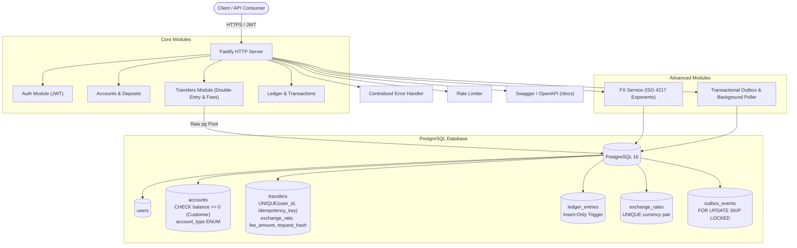
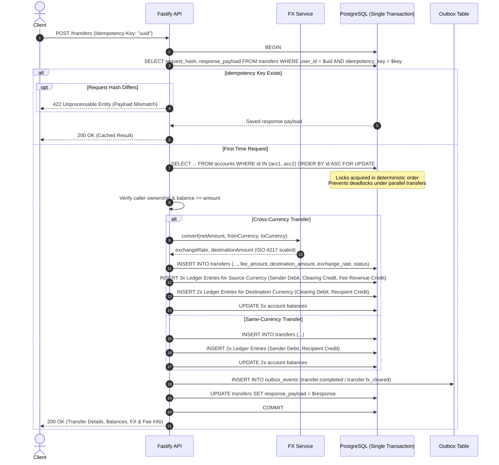
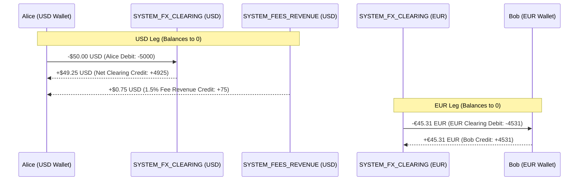
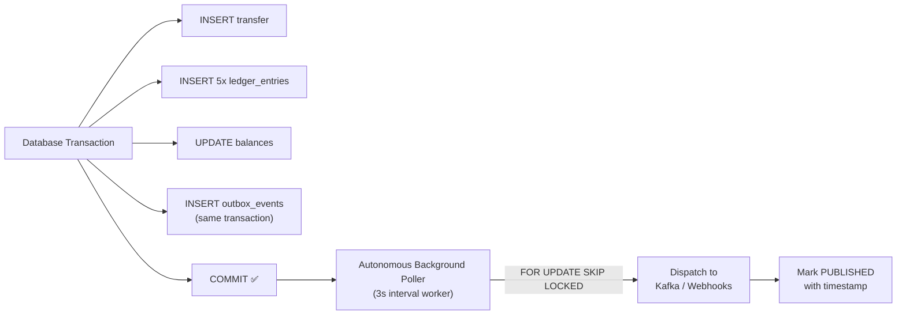

# Digital Wallet & Double-Entry Ledger API

A production-grade, backend-only digital wallet and financial ledger service built with **Node.js**, **TypeScript**, **Fastify**, and **PostgreSQL** using raw `pg` for all transaction-critical execution.

Supports **multi-currency transfers** with configurable exchange rates, a **formal Chart of Accounts** (Asset, Liability, Revenue), a **transaction fee engine**, and an **event-driven Transactional Outbox** for reliable downstream messaging.

---

## Table of Contents

- [Architecture Overview](#architecture-overview)
- [Key Features](#key-features)
- [Transfer Transaction Pipeline](#transfer-transaction-pipeline)
- [Multi-Currency FX Transfer Flow & True Double-Entry](#multi-currency-fx-transfer-flow--true-double-entry)
- [Chart of Accounts](#chart-of-accounts)
- [Transactional Outbox & Background Poller](#transactional-outbox--background-poller)
- [Database Schema (10 Migrations)](#database-schema-10-migrations)
- [API Endpoints](#api-endpoints)
- [Stripe-Style Idempotency Engine & Race Safety](#stripe-style-idempotency-engine--race-safety)
- [Clearing Accounts & System Inventory Rebalancing](#clearing-accounts--system-inventory-rebalancing)
- [Design Decisions & Trade-Offs](#design-decisions--trade-offs)
- [Getting Started](#getting-started)
- [Running the Automated Test Suite](#running-the-automated-test-suite)
- [Scripts & Tooling](#scripts--tooling)
- [Project Structure](#project-structure)
- [Tech Stack](#tech-stack)
- [Next Steps / Roadmap](#next-steps--roadmap)

---

## Architecture Overview

The system strictly implements **double-entry bookkeeping principles**:
- Money is never created or destroyed arbitrarily. Every transfer creates balanced ledger entries where debits equal credits:
  - **Same-Currency Transfers:** 2 balancing ledger entries (Sender Debit `-amount`, Recipient Credit `+amount`) where $\sum \text{entries} = 0$.
  - **Cross-Currency Transfers:** 5 balancing ledger entries across two balanced legs including the transaction fee (Sender Debit, Source Clearing Credit, Fee Revenue Credit, Target Clearing Debit, Recipient Credit) where each currency balances independently to zero ($\sum = 0$).
- The `ledger_entries` table is **append-only and immutable**, enforced by a database trigger preventing `UPDATE` and `DELETE` operations.
- Account balances are cached directly on `accounts.balance` for $O(1)$ read performance, guaranteed strictly consistent via database transactions and row-level locks.
- A standalone financial reconciliation script (`scripts/reconcile.ts`) audits all customer accounts and verifies per-currency conservation ($\sum = 0$) across all ledger transactions.



---

## Key Features

| Feature | Description |
|---------|-------------|
| **Double-Entry Bookkeeping** | Every transaction creates balanced debit + credit ledger entries. Ledger is append-only and immutable (database trigger enforced). |
| **Atomic Transfers** | Entire transfer logic executes within a single PostgreSQL `BEGIN...COMMIT` transaction with row-level locking. |
| **User-Scoped Idempotency** | Composite unique index `(user_id, idempotency_key)` with `request_hash` SHA-256 fingerprinting. Reused keys with altered payloads return HTTP 422. Concurrent races trap `23505`, rollback, and fetch winner payload. |
| **Deadlock Prevention** | Accounts always locked in ascending UUID order (`ORDER BY id ASC`) to prevent cyclic waits under parallel bi-directional transfers. |
| **Multi-Currency FX & Fees** | Cross-currency transfers (`USD → EUR`, `GBP → JPY`, etc.) using configurable exchange rates, ISO 4217 minor-unit exponent scaling, and a 1.5% fee engine. |
| **Chart of Accounts** | Formal account types: `CUSTOMER_WALLET`, `SYSTEM_BANK_CASH`, `SYSTEM_FX_CLEARING`, `SYSTEM_FEES_REVENUE`. |
| **Transactional Outbox** | Domain events emitted atomically inside the same DB transaction. Continuous in-process background worker dispatches events safely with `FOR UPDATE SKIP LOCKED`. |
| **Constant-Time Admin Auth** | Internal admin endpoints (`/outbox/*`) protected by `X-Admin-Key` verified using `crypto.timingSafeEqual`. |
| **Transfer Reversals** | Append-only reversal pattern: restricted to original sender/admin, creates new offsetting entries without editing ledger history. |
| **Cursor-Based Pagination** | Stable, performant pagination using composite `(created_at, id)` cursors instead of OFFSET/LIMIT. |
| **Financial Reconciliation** | Standalone script audits customer cached balances against ledger sums and verifies per-currency double-entry conservation across all accounts. |
| **Rate Limiting** | Per-endpoint rate limiting on auth and transfer routes to prevent abuse. |
| **OpenAPI / Swagger** | Auto-generated interactive API docs at `/docs`. |
| **100-Transfer Concurrency Test** | Proves zero deadlocks, exact balance invariance, and $\Sigma\text{ledger} = 0$ under parallel load. |

---

## Transfer Transaction Pipeline

Every money transfer executes within an isolated PostgreSQL transaction adhering to strict deadlock prevention and concurrency safety:



---

## Multi-Currency FX Transfer Flow & True Double-Entry

Cross-currency transfers use **true double-entry balancing** via `SYSTEM_FX_CLEARING` and `SYSTEM_FEES_REVENUE` accounts. In financial accounting, currency values cannot be summed directly across borders ($\text{USD} + \text{EUR} \neq 0$). Therefore, the engine executes **5 immutable ledger entries across two independently balanced currency legs**:



**Properties:**
1. **Per-Currency Conservation ($\sum = 0$):**
   * **Source Currency (USD):** $-5000 + 4925 + 75 = 0$
   * **Destination Currency (EUR):** $-4531 + 4531 = 0$
   Both currencies balance to zero independently inside the single ACID transaction.
2. **Platform Inventory & Revenue Tracking:**
   * Clearing accounts continuously reflect the platform's net FX exposure/inventory.
   * `SYSTEM_FEES_REVENUE` accounts accumulate fee margins earned by the platform.
3. **ISO 4217 Minor-Unit Exponent Normalization:** Currencies have variable decimal exponents ($10^{\text{target\_exp} - \text{base\_exp}}$):
   - **USD, EUR, GBP:** 2 decimal places ($1 = 100\text{ cents}$)
   - **JPY, KRW:** 0 decimal places ($1 = 1\text{ yen}$)
   - **BHD, KWD:** 3 decimal places ($1 = 1000\text{ fils}$)
   - *Example:* A $50.00 USD (5,000 cents) transfer to JPY with 1.5% fee ($75\text{ cents}$) leaves $4,925\text{ cents}$ net. At rate $150.0$, it converts to $4925 \times 150 \times 10^{0 - 2} = 7,388\text{ JPY}$ (¥7,388), avoiding a 100x over-crediting bug.

---

## Chart of Accounts

The engine uses a formal **Chart of Accounts** with typed accounts:

| Account Type | Purpose | Has Owner? |
|---|---|---|
| `CUSTOMER_WALLET` | End-user wallet (default) | Yes (`user_id`) |
| `SYSTEM_BANK_CASH` | Cash reserves backing customer deposits (Asset) | No (System) |
| `SYSTEM_FX_CLEARING` | Balanced clearing accounts for multi-currency settlements | No (System) |
| `SYSTEM_FEES_REVENUE` | Revenue from processing fees and spreads | No (System) |

**Pre-provisioned system accounts:**
- `USD`, `EUR`, `GBP`, `JPY` Bank Cash accounts
- `USD`, `EUR`, `GBP`, `JPY` FX Clearing accounts
- `USD`, `EUR`, `GBP`, `JPY` Fee Revenue accounts

---

## Transactional Outbox & Background Poller

The **Transactional Outbox Pattern** guarantees reliable, atomic event emission:



**Security & Architecture:**
- **Automated Background Poller:** Runs continuously inside the process (configurable via `OUTBOX_POLL_INTERVAL_MS`), using `FOR UPDATE SKIP LOCKED` for concurrent cluster safety.
- **Admin Authentication:** The HTTP event audit endpoints (`GET /outbox/events` and `POST /outbox/process`) are locked behind constant-time `X-Admin-Key` verification to protect sensitive financial payloads.
- **At-Least-Once Delivery:** Events are guaranteed to be dispatched at least once. Downstream consumers should process events idempotently using `eventId`.

---

## Database Schema (10 Migrations)

| # | Migration | Description |
|---|---|---|
| 001 | `create_users` | Users table with UUID PK, unique email, bcrypt hash |
| 002 | `create_accounts` | Accounts with `BIGINT balance`, `CHECK >= 0`, user FK |
| 003 | `create_transfers` | Transfers with `UNIQUE idempotency_key`, `response_payload JSONB`, status enum |
| 004 | `create_ledger_entries` | Insert-only ledger entries with transfer + account FKs |
| 005 | `prevent_ledger_tampering` | PostgreSQL trigger blocking `UPDATE`/`DELETE` on ledger |
| 006 | `chart_of_accounts` | `account_type` enum, pre-provisioned system accounts |
| 007 | `exchange_rates` | Configurable FX rates table, `destination_amount`/`exchange_rate` columns, 8 seeded pairs |
| 008 | `outbox_events` | Outbox table with status tracking, retry count, indexed on `(status, created_at)` |
| 009 | `harden_transfers_and_system_accounts` | Added `user_id`, `request_hash`, `fee_amount`, plus JPY & GBP system accounts |
| 010 | `system_account_constraint_and_scoped_idempotency` | Exempted system clearing accounts from non-negative balance checks; scoped idempotency to `(user_id, idempotency_key)` |

---

## API Endpoints

| Method | Endpoint | Description | Auth |
|---|---|---|---|
| `POST` | `/auth/register` | Register a new user | No (Rate-limited) |
| `POST` | `/auth/login` | Authenticate and obtain JWT token | No (Rate-limited) |
| `POST` | `/accounts` | Create a new wallet account | Yes |
| `GET` | `/accounts/:id` | Fetch account balance and info | Yes (Owner) |
| `POST` | `/accounts/:id/deposit` | Atomically deposit funds | Yes (Owner) |
| `POST` | `/transfers` | Transfer money with double-entry ledger & fee engine | Yes (Owner, Rate-limited) |
| `POST` | `/transfers/:id/reverse` | Reverse a completed transfer | Yes (Original Sender / Admin) |
| `GET` | `/accounts/:id/transactions` | Cursor-paginated ledger entries with date/type filters | Yes (Owner) |
| `GET` | `/fx/rates` | List configurable FX exchange rates | No |
| `GET` | `/outbox/events` | Query outbox audit log (sensitive payloads) | **Admin** (`X-Admin-Key`) |
| `POST` | `/outbox/process` | Trigger manual processing of pending outbox events | **Admin** (`X-Admin-Key`) |
| `GET` | `/health` | Health check for API and PostgreSQL | No |
| `GET` | `/docs` | Interactive Swagger / OpenAPI UI | No |

---

## Stripe-Style Idempotency Engine & Race Safety

The idempotency layer handles real-world distributed edge cases:
1. **User-Scoped Idempotency:** The uniqueness index is scoped to `UNIQUE(user_id, idempotency_key)`. Two distinct users can safely use identical client keys without collisions.
2. **Request Fingerprinting (SHA-256):** Every transfer computes `SHA256(userId + fromAccountId + toAccountId + amount)`.
3. **Payload Mismatch Protection (HTTP 422):** If a client retries with an identical `Idempotency-Key` but alters the payload (e.g. changing amount from $10 to $500), the request is rejected with `422 Unprocessable Entity`.
4. **PostgreSQL 23505 Unique Violation & Transaction Abort Safety:** When two concurrent requests with identical keys pass the initial check simultaneously, one hits Postgres error `23505 (unique_violation)`. PostgreSQL aborts that transaction immediately. The engine catches `23505`, **rolls back the aborted transaction**, and in a fresh read transaction polls the committed winning record to return the response cleanly without raising an unhandled 500.

---

## Clearing Accounts & System Inventory Rebalancing

- **Balance Constraint Exemption:** Customer accounts enforce `CHECK (balance >= 0)`. Migration `010` relaxes this constraint for `account_type != 'CUSTOMER_WALLET'`, allowing `SYSTEM_FX_CLEARING` accounts to hold negative balances representing the platform's net FX inventory short/long position.
- **Why System Accounts Are Exempted:** In a clearing model, clearing accounts act as conduits. Debiting EUR clearing to pay an EUR recipient causes the clearing account to go negative until matching reverse order flow occurs or institutional treasury rebalances it.
- **Inventory Replenishment & Spread Engine:** In production, clearing accounts do not replenish automatically. The 1.5% cross-currency fee engine credited to `SYSTEM_FEES_REVENUE` covers currency volatility and conversion costs. In an institutional setup, a treasury rebalancing engine periodically executes wholesale FX settlement batches between platform bank cash reserves and clearing accounts.
- **Reconciliation Invariant:** The reconciliation tool (`scripts/reconcile.ts`) audits both cached customer wallet balances and per-currency ledger conservation across all accounts. Across every completed transfer in the system, $\sum \text{ledger\_entries} = 0$ must hold strictly per currency.

---

## Design Decisions & Trade-Offs

### 1. Raw `pg` vs ORM (Prisma / TypeORM)
* **Decision**: Raw `pg` for all transaction-critical code.
* **Rationale**: Financial systems require explicit control over `SELECT ... FOR UPDATE`, transaction isolation levels, deterministic lock ordering, and connection checkout. ORMs introduce uncontrolled implicit queries and non-deterministic join locking.

### 2. Monetary Precision: `BIGINT` Minor Units (Cents)
* **Decision**: All balances and amounts stored as 64-bit integer cents with `CHECK (balance >= 0)` on customer wallets and `CHECK (amount > 0)`.
* **Rationale**: Floating-point suffers from binary rounding (`0.1 + 0.2 ≠ 0.3`). Integer cents provide exact arithmetic and payment gateway compatibility (Stripe, Adyen).

### 3. Deadlock Prevention via Deterministic Lock Ordering
* **Decision**: Both accounts locked using `SELECT ... FOR UPDATE ... ORDER BY id ASC`.
* **Rationale**: Bi-directional transfers ($A → B$ and $B → A$) concurrently would create cyclic waits. Deterministic ordering by UUID guarantees an invariant locking hierarchy.

### 4. Database-Enforced Ledger Immutability
* **Decision**: PostgreSQL trigger `trg_prevent_ledger_update_delete` raises an exception on any `UPDATE` or `DELETE`.
* **Rationale**: No software bug or rogue query can tamper with the financial audit trail. Reversals create new offsetting entries.

### 5. Cached Balances with Reconciliation Proof
* **Decision**: Balances cached on `accounts.balance` instead of computing `SUM(ledger_entries.amount)` per request.
* **Rationale**: On-the-fly summing is $O(N)$ over millions of rows. Cached balance provides $O(1)$ reads. Correctness proven by the reconciliation job.

### 6. User-Scoped Idempotency with In-DB Response Caching
* **Decision**: Composite index on `(user_id, idempotency_key)` with `response_payload JSONB` stored on the transfer record.
* **Rationale**: Eliminates external caching dependencies (like Redis) and guarantees zero double-spend anomalies across network retries and concurrent races.

### 7. Cursor-Based Pagination
* **Decision**: Composite `(created_at, id)` cursor instead of `OFFSET/LIMIT`.
* **Rationale**: `OFFSET` degrades to $O(N)$ on deep pages and misses/duplicates rows on concurrent inserts. Cursors use indexed lookups.

### 8. Transactional Outbox (No Dual-Write Risk)
* **Decision**: Outbox events inserted in the **same** database transaction as the financial mutation.
* **Rationale**: Avoids the dual-write problem where a transfer commits but the event publish fails (or vice versa). The outbox worker can safely retry from `PENDING` events.

### 9. FX Rate Lookup with Inverse Fallback
* **Decision**: If no direct rate exists for `USD→GBP`, the system checks `GBP→USD` and computes the inverse.
* **Rationale**: Halves the number of required rate entries. Rates are stored with `NUMERIC(18,6)` precision.

---

## Getting Started

### Prerequisites
- **Node.js** >= 20
- **PostgreSQL** >= 15 (or Docker)
- **Docker** (optional, for containerized Postgres)

### 1. Environment Setup
```bash
cp .env.example .env
npm install
```

### 2. Start PostgreSQL via Docker Compose
```bash
docker compose up -d postgres
```

### 3. Run Database Migrations
```bash
npm run migrate
```
This will create both `digital_wallet` and `digital_wallet_test` databases and apply all 10 migrations.

### 4. Start the Application
```bash
# Development mode
npm run dev

# Production build and run
npm run build
npm start
```
The server starts at `http://localhost:3000`.
Visit `http://localhost:3000/docs` for the interactive OpenAPI Swagger UI.

---

## Running the Automated Test Suite

The test suite includes integration tests, idempotency checks, FX conversion tests, outbox event tests, and a **100-parallel-transfers concurrency test**:

```bash
npm test
```

### Test Coverage

| Test Suite | What It Proves |
|---|---|
| `auth.test.ts` | Registration, login, JWT token generation, duplicate email rejection (409), input validation (400) |
| `accounts.test.ts` | Account creation, balance queries, deposits with double-entry, owner authorization (403), cursor pagination |
| `transfers.test.ts` | Atomic transfers, authorization checks, insufficient funds rollback (422), sender reversal with offsetting entries |
| `idempotency.test.ts` | 10 concurrent requests with same key produce exactly 1 transfer, return matching payload, debit only once |
| `fx-outbox.test.ts` | 5-entry double-entry with fee engine, JPY 0-decimal scale conversion, Stripe 422 mismatch rejection, constant-time `X-Admin-Key` verification (400/403/200), outbox dispatch |
| `parallel-transfers.test.ts` | 100 concurrent bi-directional transfers: zero deadlocks (`ORDER BY id ASC`), exact balance invariance, $\Sigma\text{ledger} = 0$ |

---

## Scripts & Tooling

```bash
npm run dev          # Start development server (port 3000)
npm run build        # Compile TypeScript to dist/
npm start            # Run production build
npm run migrate      # Run all database migrations
npm run reconcile    # Audit: compare cached balances vs. ledger SUM
npm run demo         # Run live end-to-end demo script
npm test             # Run all tests
npm run test:watch   # Watch mode
npm run test:coverage # Generate coverage report
```

### Load Testing
```bash
k6 run load-tests/k6-transfers.js
```

---

## Project Structure

```
digital-wallet/
├── migrations/                    # Sequential SQL migrations (001-010)
│   ├── 001_create_users.sql
│   ├── 002_create_accounts.sql
│   ├── 003_create_transfers.sql
│   ├── 004_create_ledger_entries.sql
│   ├── 005_prevent_ledger_tampering.sql
│   ├── 006_chart_of_accounts.sql       # Account types & system accounts
│   ├── 007_exchange_rates.sql          # Configurable FX rates table & seeded pairs
│   ├── 008_outbox_events.sql           # Transactional outbox table
│   ├── 009_harden_transfers_and_system_accounts.sql  # User IDs, fee_amount, request_hash
│   └── 010_system_account_constraint_and_scoped_idempotency.sql # Clearing constraint & user-scoped index
├── src/
│   ├── config/
│   │   ├── database.ts                 # pg Pool, withTransaction helper
│   │   └── env.ts                      # Zod-validated environment config
│   ├── modules/
│   │   ├── auth/                       # Register, Login, JWT
│   │   ├── accounts/                   # CRUD, Deposits with double-entry
│   │   ├── transfers/                  # Atomic transfers, FX clearing, fee engine, reversals
│   │   ├── ledger/                     # Cursor-paginated transaction queries
│   │   ├── fx/                         # FX rate lookup & currency conversion (ISO 4217 exponents)
│   │   └── outbox/                     # Event emission & background poller worker
│   ├── plugins/
│   │   ├── auth.plugin.ts              # JWT verification hook
│   │   ├── error-handler.ts            # Centralized error handler
│   │   ├── rate-limit.plugin.ts        # Per-endpoint rate limiting
│   │   └── swagger.plugin.ts           # OpenAPI / Swagger UI
│   ├── utils/
│   │   ├── errors.ts                   # Custom error classes
│   │   └── logger.ts                   # Pino structured logger
│   ├── app.ts                          # Fastify app builder
│   └── server.ts                       # Entry point with graceful shutdown & background poller
├── scripts/
│   ├── migrate.ts                      # Migration runner
│   ├── setup-db.ts                     # DB creation + migration
│   ├── reconcile.ts                    # Per-currency double-entry ledger audit
│   └── demo.ts                         # Live end-to-end demo
├── tests/
│   ├── helpers/test-db.ts              # Test setup, fixtures, cleanup
│   ├── integration/                    # Auth, accounts, transfers, FX, outbox tests
│   └── concurrency/                    # 100-parallel-transfer test
├── load-tests/
│   └── k6-transfers.js                 # k6 load testing script
├── docker-compose.yml                  # PostgreSQL 16 container
├── Dockerfile                          # Multi-stage production build (non-root, health check)
├── package.json
├── tsconfig.json
└── jest.config.ts
```

---

## Tech Stack

| Layer | Technology |
|---|---|
| Runtime | Node.js 22 + TypeScript 5.7 |
| Framework | Fastify 5 |
| Database | PostgreSQL 16 (raw `pg` — no ORM) |
| Validation | Zod |
| Auth | `@fastify/jwt` + bcryptjs |
| API Docs | `@fastify/swagger` + `@fastify/swagger-ui` |
| Rate Limiting | `@fastify/rate-limit` |
| Testing | Jest + Supertest (via Fastify `inject`) |
| Logging | Pino + pino-pretty |
| Containerization | Docker + Docker Compose |
| Load Testing | k6 |

---

## Next Steps / Roadmap

The following improvements outline the path toward institutional-scale operation:

### 🔴 High Priority

1. **Two-Phase Transfers (Auth & Capture)**
   - Support `AUTHORIZED` → `CAPTURED` / `VOIDED` lifecycle
   - Split `balance` into `available_balance` and `settled_balance` on accounts
   - Enables payment hold/capture flows (e-commerce, pre-auth)

2. **Automated Background Reconciliation Daemon**
   - Package `reconcile.ts` as a BullMQ scheduled worker or cron job
   - Auto-freeze accounts on discrepancy detection
   - Alert via Slack/PagerDuty webhook on balance mismatch

3. **Webhook Delivery System**
   - Outbox worker dispatches events to registered webhook URLs
   - HMAC-SHA256 signed payloads for verification
   - Exponential backoff retry with dead-letter queue

### 🟡 Medium Priority

4. **Account Freezing & KYC States**
   - `account_status` enum: `ACTIVE`, `FROZEN`, `SUSPENDED`, `CLOSED`
   - Block transfers from/to non-active accounts
   - Admin endpoints for freeze/unfreeze with audit trail

5. **Prometheus Metrics & OpenTelemetry**
   - `/metrics` endpoint: `wallet_transfers_total`, `transfer_latency_seconds`, `pg_pool_idle_connections`
   - Distributed tracing with trace IDs propagated across DB queries
   - Grafana dashboard templates

6. **Treasury Clearing Auto-Hedging & Rebalancing Engine**
   - Automated inventory threshold triggers: when a clearing account drops below $-X, execute a wholesale hedging trade
   - Dynamic FX spreads based on inventory skew and order flow imbalance

### 🟢 Nice to Have

7. **Configurable Tiered Fee Schedules**
   - Dynamic fee rules based on account tier or monthly transaction volume
   - Support flat fee + percentage combinations

8. **Scheduled / Recurring Transfers**
   - Cron-based scheduled transfers with BullMQ
   - Recurring payment support (subscriptions, payroll)

9. **Multi-Tenant Support**
   - Tenant-scoped data isolation via `tenant_id` column or PostgreSQL Row-Level Security
   - Separate API keys per tenant

10. **Audit Log Table**
    - Dedicated `audit_logs` table tracking every admin action, config change, and account state transition
    - Immutable, append-only, indexed by timestamp and actor

---

## License

MIT
